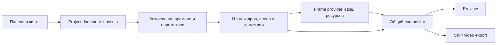

# TimeGrid: технический и творческий аудит

24 сентября 2026. Основа: локальная версия **28.33**, HEAD `e2a95ea` и существующая документация. Это исследование для обсуждения, а не утверждённый план переписывания приложения.

Код приложения не изменён. Существующие незакоммиченные изменения не затронуты. Добавлены только этот разбор и материалы измерений.

## 1. Главный вывод

У TimeGrid уже есть самостоятельная модель инструмента: **выбирать время, размещать его в пространстве и играть получившейся структурой**. Contact sheet, рисунки, temporal effects и звук — разные способы работы с этой моделью. Документы о сценариях, архиве и перформативности согласуются с тем, что реализовано в приложении.

Во время аудита автор уточнил определение: **фрейм-сэмплер и секвенсер**. Главные текущие боли — рисование, особенно на телефоне, и temporal effects, включая Chronophoto и Frame Diff. Желаемое развитие: более сложное смешивание кадров, звук, анимация параметров, последовательности разных состояний и автоматическое исполнение. Сохранить характер любимого инструмента важнее, чем расширять его до универсального монтажного редактора. Mobile, web studio, desktop и будущая продажа лицензий/подписок рассматриваются как направления, а не принятые решения.

Для следующего этапа особенно важны три опоры:

1. **Восстановимый эксперимент:** источники, выборка кадров, параметры, рисунки и варианты должны существовать как данные проекта, независимо от текущей вкладки.
2. **Общий расчёт композиции на заданный момент:** preview, still и video export должны получать одинаковые кадры, параметры и порядок слоёв.
3. **Управляемая стоимость отображения:** выбирать нужное разрешение, обрабатывать только нужные ячейки и ограничивать память.

Эти задачи связаны. Одно только добавление кнопки Save не решит воспроизводимость; одно только уменьшение кадров не устранит задержки кисти; переход на GPU сам по себе не обеспечит скорость.

Моя рекомендация — сохранить творческую модель и постепенно заменить её техническую основу. ES-модули, общий документ проекта и отдельный renderer совместимы с текущей сборкой в один HTML. Переход на React, сервер или Electron для этого не обязателен.

## 2. Что изучено и как проверялось

Прочитаны README, проектная карта, backlog, история разработки, Chronophoto, пользовательские сценарии, справка и материалы о назначении инструмента. Архивные анализы и заметки использованы выборочно как история решений; старые HTML-версии не проходили полный повторный аудит.

В текущем коде прослежены import/capture, sampling, layout, playback, эффекты, drawing/undo, save points, экспорт и audio. `src/js/main.js` содержит 16 183 строки и около 485 объявлений функций, включая вложенные. HTML и CSS отделены, но логика остаётся в большом IIFE с общим изменяемым `state`.

Практические проверки:

- Production build во временную папку: успешно. Осталось предупреждение о deprecated Vite CJS API; старого предупреждения про расположение `inlineDynamicImports` больше нет.
- Запуск локального приложения: UI отображается, Vite error overlay и необработанных JS-ошибок в проверенных сценариях нет.
- Извлечение кадров и playback на синтетическом H.264 1920×1080, 24 fps, 8 секунд, 192 исходных кадра.
- Сравнение 24 и 96 ячеек, качества 0.5 и 0.125, Chronophoto, Colorama и motion mask Frame Diff.
- Измерение работы кисти и отдельных графических вызовов.
- Настоящий MP4 export: файл проверен через ffprobe, H.264, 72 кадра, 14 fps.
- Отдельные воспроизведения ошибок геометрии, композиции и асинхронной сборки сетки.

Среда измерений: отдельный headless Edge 153 на Windows, AMD Radeon 890M через ANGLE/D3D11, viewport 1440×1000, DPR 1. Замеры добавлялись в ответ локального сервера внутри тестового браузера; исходный `main.js` на диске оставался прежним.

**Границы выводов:** это диагностические прогоны, а не статистический benchmark всех устройств. Замеры JS включают возможное ожидание графических операций, но не измеряют отдельно всё GPU-время и всю память процесса. Физические iPad/Pencil, Safari, Firefox, 4K/8K пользовательские материалы, VFR и длинный A/V export не проверялись. Причины конкретного пользовательского торможения нужно сопоставить с его материалом и устройством.

Сырые результаты находятся в `docs/audit-evidence/2026-09-24/`. В `profile.json` время обёртки асинхронной `captureFrame` отражает только синхронный вход в функцию: для длительности импорта использовать `wallMs`, а не её `sumMs`. Неудачные прогоны рисования с пустым `stats` не использованы для выводов: начальная точка не попадала в drawing overlay.

## 3. Что TimeGrid представляет собой сейчас

В центре находится не видеофайл как линейная дорожка, а **банк выбранных кадров**. Затем TimeGrid связывает элементы банка с ячейками сетки через время, фазу и пространственный порядок.

Это объясняет сильные стороны инструмента:

- Сэмплирование само является художественным действием: изменяя плотность и выбор кадров, можно переходить от читаемого движения к орнаменту.
- Pattern и Direction задают разные вещи: размещение фаз по поверхности и движение внутри последовательности.
- Chronophoto показывает историю движения внутри ячейки; Frame Diff — изменение относительно plate.
- BG, TPL и FRM дают три разных отношения рисунка ко времени: поверхность, повторяемый шаблон и конкретный кадр.
- Audio Collision превращает попадание кадра в определённую ячейку в событие.
- Экспорт — полноценный результат эксперимента, поэтому его соответствие preview принципиально.

Идея сохранять и возвращать эксперименты особенно подходит этому устройству. Пользователь должен иметь возможность сохранить найденную конфигурацию, сделать ответвление, сравнить варианты и продолжить позднее. Для этого необязательно строить традиционный монтажный редактор с множеством дорожек.

## 4. Как устроены основные системы

| Система | Фактическая реализация | Следствие |
|---|---|---|
| Источник и sampling | Локальный File → object URL → HTML video/Image. Видео последовательно seek-ится; кадры проходят Canvas → JPEG data URL | Простой работающий путь, но декодирование, ресайз, сжатие и хранение кадров связаны |
| Изображения | Серия файлов переиспользует URLs; Slice физически вырезает PNG-фрагменты | Исходная фотография и производные tiles пока не разделены в полноценной модели источников |
| Пространство и время | `getFrameCellInfo`, layout helpers, phase offsets, direction, shuffle, loop windows | Уже есть подходящее ядро для общей модели композиции |
| Preview | DOM grid с ``, CSS transforms/blends, SVG Colorama, дополнительные canvas; drawing — общий overlay | Гибко для UI, но эффекты и геометрия имеют несколько путей исполнения |
| Drawing | BG отдельно для grid/single, TPL, большой FRM atlas; undo частично по tiles | Рисунки привязаны к растровым размерам и раскладке; единая сетка требует большой памяти |
| Export | Отдельные still/grid/single пути; Canvas → WebCodecs + встроенный mp4-muxer; A/V также через MediaRecorder | Есть offline-покадровый video export, но нет единого полного render contract |
| Audio | Web Audio, 4 slots, mappings и playheads; отдельные режимы исходного аудио и Audio Montage | Хорошая событийная идея, но clock, обработка и экспорт ещё неоднородны |
| Сохранение | Drawing slots в памяти, немного localStorage для recent colors и slice settings | Полного документа проекта, сохранения на диск и восстановления медиа нет |

Основные ориентиры в коде:

- [Импорт и извлечение кадров](D:/Antigravity/TimeGrid/src/js/main.js:1255).
- [Модель ячеек и фаз](D:/Antigravity/TimeGrid/src/js/main.js:2705).
- [Обновление preview](D:/Antigravity/TimeGrid/src/js/main.js:6345).
- [Drawing sheet и композиция](D:/Antigravity/TimeGrid/src/js/main.js:7621).
- [MP4 export](D:/Antigravity/TimeGrid/src/js/main.js:11235).
- [Save points](D:/Antigravity/TimeGrid/src/js/main.js:16011).

## 5. Что уже сделано хорошо

Нельзя считать все проблемы из старых аудитов всё ещё отсутствующими оптимизациями. В текущем коде уже есть:

- Кэш основных DOM-ссылок и порядка ячеек.
- Общий `getFrameCellInfo` для нескольких preview/export путей.
- `requestComposite`, объединяющий запросы на перерисовку в rAF.
- Undo по затронутым FRM tiles вместо обязательной копии всего atlas на каждый обычный stroke.
- Ограничения площади и сторон canvas; снижение DPR на coarse pointer.
- Нормализованные UV-координаты в long stroke.
- Seeded shuffle для части random-поведения.
- Общие seam helpers и реализованный Seam Blend.
- WebGL-шейдер motion mask с CPU fallback и уменьшенным mask resolution.
- Батчи при создании больших DOM-сеток и загрузке экспортных изображений.
- WebCodecs MP4, а также AudioEncoder для Audio Montage.
- Ясно сформулированный в документах принцип совпадения preview/export.

Сохранять стоит не каждую деталь реализации, а эти уже найденные границы и творческие правила.

## 6. Что действительно тормозит

### 6.1 Измеренные различия

При target playback 14 fps:

| Сценарий | Медиана `updateAllCells` | p95 | Фактическое продвижение tick, примерно |
|---|---:|---:|---:|
| 24 ячейки, без эффектов | 1.1 мс | 1.4 мс | 13.6/с |
| 24, Colorama Cascade + Speed | 2.0 мс | 2.5 мс | 13.6/с |
| 24, Chronophoto depth 8 | 3.6 мс | 4.6 мс | 13.6/с |
| 24, Frame Diff color-motion-white | 37.2 мс | 82.0 мс | 13.6/с, с заметным падением UI cadence |
| 96, без эффектов, capture 960×540 | 2.4 мс | 3.2 мс | 13.6/с |
| 96, Chronophoto depth 8, 960×540 | 7.1 мс | 7.7 мс | 13.8/с |
| 96, Chronophoto depth 32, 960×540 | 22.3 мс | 24.5 мс | 13.7/с, UI cadence около 42/с |
| 96, Chronophoto depth 32, 240×135 | 22.2 мс | 23.9 мс | 13.7/с, UI cadence около 46/с |
| 96, color-motion-white, 960×540 | 147.4 мс | 367.5 мс | 5.1/с |
| 96, color-motion-white, 240×135 | 100.8 мс | 134.4 мс | 8.5/с |

Это подтверждает: «вся программа медленная» — недостаточно точный диагноз. Базовая сетка в этой среде относительно лёгкая; отдельный путь эффекта радикально меняет стоимость кадра. FPS из панели Info — частота rAF, а не точное число отрисованных animation ticks.

У Chronophoto другой профиль нагрузки: [`updateChronoForItem`](D:/Antigravity/TimeGrid/src/js/main.js:5324) поддерживает отдельные DOM-изображения ghosts. При 96 ячейках depth 8 дал 864 изображения в сетке, depth 32 — 3168. Уменьшение capture до 240×135 почти не изменило JS-время обновления. Это подтверждает существенную стоимость количества слоёв; стоимость их последующей отрисовки браузером не полностью входит в `updateAllCells`. На данном desktop playback ещё удерживал 14 fps, поэтому из теста нельзя заключать, что Chronophoto тормозит на всех устройствах одинаково. Для больших глубин перспективны объединение temporal layers в compositor, кэширование повторяющихся комбинаций и отдельные quality budgets для preview.

### 6.2 Frame Diff: GPU уже используется, но дорого организован

[Motion mask](D:/Antigravity/TimeGrid/src/js/main.js:5730) строит промежуточные Canvas-стеки, загружает две текстуры и возвращает результат в Canvas 2D **для каждой ячейки**. Статичная plate тоже загружается снова. GPU-ресурсы не образуют общий сохраняемый между кадрами набор текстур композиции.

Уточняющий прогон 10 обновлений × 96 ячеек на WebGL показал:

- 960 вызовов `drawArrays`: около 1.2 мс суммарного времени самих вызовов.
- 1920 `texImage2D`: около 197.6 мс.
- 2880 `getError`: около 706.7 мс.

Время `getError` здесь включает синхронизацию/ожидание ранее отправленной GPU-работы; оно не означает, что проверка числа ошибки сама вычисляет эффект. Но это конкретное место, где основной поток ждёт. Рекомендации WebGL отдельно отмечают такие синхронные остановки у `getError`/`getParameter`. [WebGL best practices](https://developer.mozilla.org/en-US/docs/Web/API/WebGL_API/WebGL_best_practices).

**Практический вывод:** сначала уменьшить число передач, синхронных проверок и промежуточных поверхностей, кэшировать plate/текстуры и группировать работу. Менять этот шейдер на WebGPU до этого преждевременно.

Дополнительно single view скрывает остальные ячейки, но `updateAllCells` продолжает обходить их. В отдельной проверке при одной видимой ячейке выполнились 96 GPU draw calls и 192 texture uploads. Preview может обрабатывать только отображаемые ячейки; логика audio collisions при этом должна вычисляться отдельно и не зависеть от видимости DOM.

### 6.3 Кисть: стоимость поиска ячейки умножается на число промежуточных точек

[`getFrameAtPoint`](D:/Antigravity/TimeGrid/src/js/main.js:7980) каждый раз собирает ячейки и читает их `getBoundingClientRect`. При пересечении ячеек [`drawFrameStrokeResampled`](D:/Antigravity/TimeGrid/src/js/main.js:8494) делает до 260 промежуточных проб, каждая повторяет этот поиск.

На успешном прогоне через 96 ячеек с маленькими capture-кадрами:

- 568 вызовов `getFrameAtPoint`;
- около 36.9 тысячи чтений геометрии за проход;
- 14 вызовов resampling: медиана 10.4 мс, максимум 40 мс;
- 21 полная композиция: медиана около 0.9 мс.

В этом конкретном прогоне значимым ограничением был поиск/маршрутизация stroke, а не только рисование пикселей. Чтение rect не всегда вызывает новый layout, поэтому считать все 36.9 тысячи вызовов отдельными forced reflow было бы неверно.

Это прогон мышью. У touch/pen есть отдельный обработчик Pointer Events: он перебирает coalesced points и также делает hit testing, но при переходе между кадрами использует другой путь. Поэтому числа desktop resampling нельзя напрямую приписывать телефону. Различие обработчиков — дополнительная причина объединить семантику ввода перед дальнейшим развитием кисти. [Pointer input](D:/Antigravity/TimeGrid/src/js/main.js:9485).

Для регулярной сетки естественны вычисление row/column из координат, общий кэш геометрии, отдельная обработка gaps и преобразование screen → composition → cell. Инвалидация нужна при изменении layout и viewport, но не при каждой точке кисти. Дальше — dirty tiles/rectangles и единый scheduler для active stroke.

### 6.4 Память выделяется раньше и шире, чем нужно

[`schedulePostGridSync`](D:/Antigravity/TimeGrid/src/js/main.js:2606) вызывает `ensureFrameSheet` после создания сетки, даже когда пользователь ещё не рисовал.

Полученные размеры FRM atlas и расчёт RGBA backing storage:

| Сетка | Atlas | `width × height × 4`, без накладных расходов |
|---|---:|---:|
| 24 кадра, quality 0.5 | 3840×3240 | 49.8 MB |
| 96 кадров, quality 0.5 | 7552×6360 | 192.1 MB |
| 96 кадров, quality 0.125 | 1920×1632 | 12.5 MB |

В последнем случае tile имеет высоту 136 из-за округления к чётному размеру; source capture — 135.

Отдельно существуют decoded image surfaces, строки JPEG data URL, overlay, BG grid/single, underlay, template, undo и временные копии. Например, drawing overlay 2960×2660 — около 31.5 MB на одну RGBA-поверхность. Несколько таких canvas и ImageData быстро складываются. Это расчёт объёма пикселей, не измерение реального RSS браузера.

Рекомендации:

- Не выделять FRM atlas до появления рисунков; затем перейти к выделению только затронутых tiles или страниц atlas.
- Отвязать логическое хранение рисунка от `gridCols`: сейчас изменение раскладки может перепаковывать и масштабировать его.
- Ограничивать undo и кэши байтами, а не только количеством записей. Сейчас лимит undo — 8 действий, но размеры действий разные.
- Отличать «слой пустой» от «существует canvas/ImageData». После resize могут появляться снимки прозрачного BG, из-за которых ветки считают overlay существующим.
- При смене проекта явно освобождать bitmaps, object URLs, textures и устаревшие задания.

### 6.5 Извлечение кадров: proxy-размер не устраняет seek

96 кадров извлекались примерно за 9.5 с при quality 0.5 и 9.0 с при 0.125, включая фиксированное ожидание 0.4 с после генерации. Разница мала по сравнению с сокращением числа пикселей в 16 раз.

Текущий путь последовательно перемещает video element по таймкодам и ждёт готовности; обычный capture дополнительно проходит через двойной rAF. `drawImageHQ` при уменьшении создаёт промежуточный canvas исходного размера и ступени ресайза. Затем каждый кадр синхронно кодируется в JPEG data URL.

Значит, уменьшенные извлечённые кадры хорошо сокращают хранение и часть рендера, но не превращают оригинальный видеофайл в дешёвый для seek/decode источник. Для ускорения именно импорта понадобятся reuse буферов, другая стратегия декодирования или настоящий proxy media, в зависимости от материала. Data URL также хранит всё закодированное изображение строкой; Blob/bitmap cache — более подходящая граница хранения. [Canvas `toDataURL`](https://developer.mozilla.org/en-US/docs/Web/API/HTMLCanvasElement/toDataURL).

### 6.6 Работа, которую сейчас делают без необходимости

- [`updateColoramaSVG`](D:/Antigravity/TimeGrid/src/js/main.js:11947) вызывается из каждого `updateAllCells` и пересоздаёт `defs.innerHTML`, включая случаи выключенной Colorama. Cascade создаёт отдельный фильтр на ячейку. Нужны ключ кэша и обновление по изменению параметров.
- Timecode spans пересоздаются на каждом обновлении, если метки включены.
- Audio chips обходят DOM даже при пустом mapping и выключенном sequencer.
- Отключённые эффекты всё равно делают запросы к DOM для удаления потенциальных слоёв.
- Полная drawing-композиция повторяет чтение геометрии по слоям и очищает всю поверхность.

Эти расходы подтверждены кодом; в небольших тестах они уступают motion mask. Их важно ранжировать, а не объявлять все одинаково критичными.

### 6.7 Экспорт: очередь и UI

MP4 использует WebCodecs, но отправляет кадры без контроля `encodeQueueSize`. В тесте 72 кадров очередь дошла до 71 ожидающего запроса. Сам `VideoFrame.close()` вызывается, что правильно; незавершённая работа кодировщика всё равно требует ресурсов.

Встречающийся `await new Promise(r => queueMicrotask(r))` не даёт полноценного окна для отрисовки UI: очередь microtasks обрабатывается до следующего render opportunity. Нужны реальное разбиение работы/worker и backpressure. Для финального экспорта при заполнении очереди следует ждать, сохраняя все кадры. [Microtask guide](https://developer.mozilla.org/en-US/docs/Web/API/HTML_DOM_API/Microtask_guide), [WebCodecs workflow](https://developer.chrome.com/docs/web-platform/best-practices/webcodecs).

`ArrayBufferTarget` и `fastStart: 'in-memory'` также удерживают результат в памяти. Для больших проектов целесообразен потоковый путь сохранения там, где он доступен, и общий бюджет кадров/экспорта.

### 6.8 Нужно ли менять систему рисования целиком

Есть основания заменить её хранение, координаты и исполнение ввода как отдельную подсистему, сохранив художественное поведение BG/TPL/FRM и long stroke. Мелкие правки hit testing дадут полезный ранний эффект, но не решат привязку рисунков к capture resolution и перестройке sheet.

Предлагаемая граница нового drawing engine:

1. Один поток stroke samples для мыши, touch и pen: координаты, timestamp, при наличии pressure. Геометрия преобразуется по подготовленной модели, без поиска DOM для каждой точки.
2. BG/TPL/FRM остаются разными типами привязки. FRM хранится по устойчивому sample/occurrence ID; общий atlas становится лишь возможным runtime-кэшем.
3. Растровые tiles появляются по необходимости. Пустые кадры не резервируют заранее огромную поверхность; undo хранит изменённые tiles в пределах бюджета байтов.
4. Active stroke получает быстрый preview; тяжёлая композиция обновляется согласованно с кадром. Сохраняются исходные точки, даже если экран не успел показать каждую промежуточную стадию.
5. Бюджеты preview, undo и GPU textures раздельны. Статичные слои кэшируются; грязные области пересчитываются там, где эффект допускает локальное обновление.
6. Существующие рисунки импортируются как raster assets; stroke replay можно добавить без потери старых работ.

На coarse pointer текущий лимит одного draw canvas — 10 миллионов пикселей: примерно 40 MB RGBA до дополнительных копий. Несколько поверхностей, undo и декодированные изображения складываются. Снижение DPR и мобильный CSS уже есть, но это не общий бюджет памяти. Эти расчёты объясняют риск, а не заменяют профилирование физического телефона.

Для интерактивного рисования приоритет ввода может временно снижать **качество отображения** тяжёлых эффектов. Их сохранённые параметры и финальный рендер должны оставаться прежними. Такое снижение следует показывать как preview quality, а не молча менять глубину эффекта в проекте.

## 7. Подтверждённые ограничения и ошибки, важные для дальнейшего развития

| Приоритет | Наблюдение | Почему существенно |
|---|---|---|
| Высокий | `generateFrames` начинает с очистки рисунков и undo | Даже смена capture quality мешает неразрушающему proxy workflow |
| Высокий | Исходный FPS фактически остаётся 30 | 24 fps / 192-frame видео показано как 240 source frames; frame numbers и диапазоны нельзя считать точными |
| Высокий | Экспорт использует извлечённые `dataUrl`, без повторного получения кадров оригинального разрешения | `Max` задаёт размер output, но не восстанавливает утраченную детализацию |
| Высокий | Colorama Speed изменяет offset только в playback rAF | В настоящем MP4 все 72 кадра имели один offset `0.17`, хотя speed = 1 |
| Высокий | Обычный MP4 стартует с tick 0 при `exportResetPlay=false` | Проверка с текущим tick 7 всё равно дала экспорт 0…71 |
| Средний | MP4 использует исходное `spacing`, другие пути — `getExportScaledGap` | Для spacing 24 и logical cell width 1920 получили gap 24 против 192 |
| Средний | BG above рисуется дважды в preview compositor | Из исходной alpha 128 получилось 192; это меняет вид полупрозрачного рисунка |
| Средний | Старая асинхронная сборка grid не отменяется при следующей маленькой синхронной сборке | Быстрая смена 240 → 6 ячеек оставила 246 DOM-ячеек |

Ориентиры: [очистка при генерации](D:/Antigravity/TimeGrid/src/js/main.js:1255), [FPS default](D:/Antigravity/TimeGrid/src/js/main.js:74), [Colorama clock](D:/Antigravity/TimeGrid/src/js/main.js:6537), [цикл MP4](D:/Antigravity/TimeGrid/src/js/main.js:11468), [BG compositor](D:/Antigravity/TimeGrid/src/js/main.js:7759), [grid batches](D:/Antigravity/TimeGrid/src/js/main.js:2854).

Дополнительные риски из чтения кода, без полного пользовательского воспроизведения:

- Still export не вызывает Colorama для основного изображения: `drawFrameCell` применяет CC, а отдельный вызов Colorama есть в video renderer. Это отдельный разрыв render paths.
- PNG/JPEG export асинхронно загружает изображения, читая mutable state и DOM в процессе: без snapshot документа/tick результат потенциально может смешать состояния.
- Общий generation token/AbortSignal отсутствует у полного capture-процесса; проверка URL после priming не защищает весь дальнейший цикл от смены источника.
- Save point хранит размеры PNG sheet, но не полноценную идентичность кадров и mapping tiles; загрузка после изменения раскладки не является надёжным project restore.
- Стабильные frame IDs отсутствуют: drawings/audio часто индексируются позицией в массиве. Пересэмплирование требует явной политики remap.
- Random direction может получать новый seed при каждом Play; случайность spray и palette также не является общим детерминированным контекстом.
- Audio mapping содержит `prob`, но текущий `audioSeqTick` запускает sample без проверки вероятности. Поле ещё не означает работающую modulation/probability систему.
- Audio Montage строит звук длительностью `ticks × sliceSeconds`, тогда как видео — `ticks / animFps`. Это может быть художественным замыслом, но их связь нужно определить явно. Полный A/V sync тест здесь не выполнен.
- Grab для каждого audio slot декодирует полный исходный файл снова. Длинное видео может быть тяжёлым даже при коротких извлекаемых samples.

Различия в preview/export — уже наблюдаемое поведение, а не только теоретический риск большого файла.

## 8. Project persistence: подходящая модель

### 8.1 Разделить три разных обещания

| Обещание | Что требуется | Что можно продолжать |
|---|---|---|
| Восстановить настройки | Recipe + ссылки на исходники | После relink — повторно сэмплировать и рендерить исходный материал |
| Восстановить редактируемый эксперимент | Recipe + drawing/reference/audio assets + исходники или сохранённые выбранные кадры | Продолжать настройки и рисунки; возможности sampling зависят от наличия оригинала |
| Открыть готовый результат как новый материал | Baked pixels + геометрия экспорта | Разрезать видимые ячейки, переиграть/дорисовать результат, но не вернуть скрытые слои и исходные пиксели |

Существующий backlog делает акцент на последнем варианте: один exported JPEG/MP4, без обязательного исходного огромного видео и без обязательных sidecar. Текущий запрос шире и включает полноценное продолжение через relink. Предлагаю сохранить оба сценария и использовать **общий versioned manifest**, но явно различать их при открытии.

### 8.2 Данные проекта должны быть отделены от runtime

Простой `JSON.stringify(state)` не годится: там смешаны File, URLs, ImageData, canvas/image caches, AudioContext, UI flags, playing state и содержательные параметры.

Нужен явный сериализуемый документ:

- `schemaVersion`, app/build version, ID проекта и ID варианта, при необходимости parent variant.
- Источники: ID, тип, имя/относительная подсказка, размер, duration/dimensions, fingerprint и информация о том, насколько он надёжен.
- Sampling recipe **и фактически выбранные samples**: время/PTS, source identity, crop для Slice, порядок, повторные вхождения.
- Grid/layout и система логических координат.
- Настройки и порядок эффектов, версии их вычислений, seeds.
- Transport: композиционный FPS, loop, сохранённый момент; отдельно source timing.
- Drawing assets и привязки, reference image, audio samples/mappings.
- Позднее — modulation bindings и keyframes.
- Thumbnail/preview найденного результата; export recipe и происхождение артефакта.

Runtime отдельно владеет декодерами, GPU textures, object URLs, DOM, pending jobs и кэшами. Editor session отдельно хранит pan/zoom, открытые панели и временное состояние ввода; часть этого можно сохранять как необязательные настройки рабочего места.

Сохранять надо и рецепт, и выборку. Один recipe может дать другой результат после исправления sampling или FPS detection. Версия алгоритма и сохранённые timestamps помогают воспроизвести старый эксперимент без изменения его смысла.

### 8.3 Форматы и их роль

| Формат/хранилище | Роль | Ограничение |
|---|---|---|
| `.timegrid` как ZIP с manifest и assets | Основной редактируемый проект; drawing/reference/audio в одном файле | Упаковка больших оригиналов увеличивает размер и требует аккуратного memory/streaming подхода |
| Проект со ссылками на оригиналы | Лёгкий повседневный вариант | Возможен relink; ссылка по имени не гарантирует правильный файл |
| Пакет с выбранными кадрами | Самодостаточный эксперимент без огромного исходного видео | Можно работать с банком сохранённых samples, но нельзя получить несохранённые моменты оригинала |
| Portable package с оригиналами | Перенос/архив и полный будущий resampling | Самый тяжёлый вариант |
| Embedded recipe в PNG/JPEG/MP4 | Удобный вход через экспортированный результат | Metadata может быть удалена; большие редактируемые слои лучше хранить в project package |
| Sidecar JSON | Прозрачный технический fallback, batch/archive workflow | Файл легко потерять; не делать обязательным для основного сценария |
| IndexedDB / OPFS | Autosave, recovery, caches | Привязано к браузеру/origin; не заменяет переносимый сохранённый проект |

Небольшая начальная версия может экспортировать JSON, если assets пока отсутствуют, но формат не должен молча выдавать такой файл за полный проект с рисунками и звуком.

### 8.4 Embedded metadata технически реалистична

Для **PNG** подходит UTF-8 JSON в `iTXt` с собственным keyword; для записи и чтения нужен контейнерный обработчик, поскольку обычный Canvas export не добавляет такой manifest. Следует проверять структуру chunks и CRC. [PNG specification](https://www.w3.org/TR/png-3/).

Для **JPEG** разумен XMP с собственным namespace. Это стандартный механизм встраивания; объём обычного APP1 ограничен, поэтому для первой версии manifest лучше держать небольшим, а большие payloads требуют Extended XMP или внешнего project package. [Adobe XMP specifications](https://developer.adobe.com/xmp/docs/xmp-specifications/).

Для **MP4** возможен custom `uuid` box или подходящая metadata-структура. UUID — предусмотренный механизм расширения ISOBMFF. Но встроенный `mp4-muxer@5.1.3` сам по себе не предоставляет TimeGrid project persistence: нужно отдельно реализовать и проверить запись/чтение контейнерных данных. Изменение расположения boxes не должно ломать sample offsets. MediaRecorder может вернуть WebM, которому требуется другой adapter. [MP4 Registration Authority](https://mp4ra.org/).

Это сохраняет обычную читаемость медиафайла. Перекодирование, редакторы и платформы распространения могут удалить metadata; проектный пакет остаётся надёжной авторской копией. Для локальных экспортов workflow реалистичен уже в web-приложении. JPEG trailing capsule и видимый QR/recovery frame из backlog можно оставить отдельными экспериментами, а не условием первой версии.

### 8.5 Как должно выглядеть повторное открытие экспорта

1. Сначала прочитать и проверить manifest файла, до обычного import/sampling.
2. Если есть editable project/source references — предложить продолжить исходный эксперимент.
3. Найти доступный источник по сохранённому handle/cache либо попросить выбрать файл. Сопоставить характеристики и fingerprint; одного filename недостаточно.
4. Восстановить оригинальные sample identities, параметры и отдельные assets.
5. Если оригинал недоступен, предложить работу с baked результатом в явно обозначенном качестве и объёме редактирования.

Для браузера абсолютный путь в JSON не даёт автоматического доступа к файлу. File handles можно хранить в IndexedDB, но доступ иногда нужно подтверждать вновь; остаётся обычный input/download fallback. Это нужно учитывать в UX relink, не обещая бесшовное открытие любых путей на любом устройстве. [File System Access](https://developer.chrome.com/docs/capabilities/web-apis/file-system-access).

**Критическая деталь baked restore:** эффекты и трансформации уже присутствуют в пикселях. При re-slicing нельзя просто снова включить весь старый effect stack — получится двойная обработка. Original recipe хранится как provenance; новая baked композиция начинает с нейтральных настроек для уже обработанных tiles.

Из grid image можно вернуть только видимые прямоугольники с текущей детализацией, включая baked labels/рисунки. Из grid video нужно учитывать и пространственную раскладку, и изменения отображаемых кадров по ticks; трактовка всего экспортированного видео как исходного клипа не восстанавливает автоматически прежний банк кадров. Начать разумно со still round-trip, затем отдельно проектировать temporal baked import.

Старые экспорты без manifest не содержат всех параметров. По геометрии иногда можно предложить ручную нарезку, но точное восстановление оригинального проекта обещать нельзя.

### 8.6 Версии экспериментов

Пользователю полезнее небольшой набор операций — **Save experiment, Save variation, Compare/Recall** — чем тяжёлая история всех внутренних мутаций.

Вариант может хранить snapshot параметров и ссылки на общие assets. Сами assets желательно идентифицировать устойчиво и не копировать при каждом изменении hue. Undo остаётся локальной историей редактирования; сохранённые варианты — долговременными точками возврата. Существующие S1/S2/S3 относятся только к рисункам в текущей сессии и не выполняют эту роль.

## 9. Proxy и финальный рендер

### 9.1 Насколько это поможет

Да, workflow подходит TimeGrid, особенно потому что в сетке исходный 4K кадр часто виден в небольшой ячейке. Но есть две разные оптимизации:

- **Preview frames/cache:** извлекать выбранные samples в 256/512/другом подходящем размере; повышать детализацию для single view/zoom.
- **Настоящий proxy media:** отдельный облегчённый видеоисточник для дешёвого декодирования/seek, с корректным соответствием времени оригиналу.

Первый вариант проще встроить и он уже частично представлен `quality`. Второй полезен, если тяжёл именно decode, но требует времени на подготовку proxy и хранения дополнительного файла. Из наших замеров не следует, что его генерация всегда окупится.

Proxy уменьшит объём decoded frames, некоторые canvas/texture операции и давление памяти. Он не устранит обход скрытых ячеек, поиск DOM rect для каждой точки кисти, пересоздание SVG, отсутствие backpressure или повторные GPU sync.

### 9.2 Нужная граница в архитектуре

Вместо «кадр = data URL»:

`sample identity → FrameProvider.get(sample, requestedResolution) → drawable resource`

Sample хранит source ID, исходное время/PTS или image crop и устойчивую идентичность. Preview просит подходящее маленькое представление; export — достаточное для фактического размера output cell. Для сетки 1080p нет необходимости всегда декодировать каждую ячейку в 4K; для single 4K такая потребность уже есть.

Export должен замораживать snapshot проекта, получать требуемые оригинальные samples, рендерить их тем же планом композиции и освобождать ресурсы по бюджету. Нельзя заранее держать все полноразмерные кадры большого проекта в памяти. Кэш зависит от source/sample/разрешения и имеет LRU/byte budget; temporal effects заранее объявляют дополнительные ghost/plate dependencies.

В качестве первого backend можно оставить существующий video seek/capture. Более точный/эффективный путь через demuxer + WebCodecs VideoDecoder потребует отдельного чтения контейнера, PTS и keyframe-aware decoding; одного вызова WebCodecs недостаточно для произвольного MP4-файла. Поддержку кодеков проверять в конкретной среде. [WebCodecs API](https://developer.mozilla.org/en-US/docs/Web/API/WebCodecs_API), [WebCodecs specification](https://www.w3.org/TR/webcodecs/).

### 9.3 Resolution-independent параметры: что готово, что нет

Уже подходят: доли/проценты offset, scale, rotation, opacity, количество кадров, phase/stride и long-stroke UV.

Нужно определить единицы для spacing, padding, шрифта, brush size, blur/edge softness и любых будущих pixel effects. Часть уже масштабируется относительно `previewCellW=240`, но это не единый договор: расхождение MP4 gap показывает последствие.

Нужны три пространства: исходное медиа, логическая композиция и экранный viewport. Pan/zoom редактора не должен случайно менять сохранённый BG или итоговый экспорт. Переход между ними должен быть явным transform, общим для preview, кисти и export.

### 9.4 Рисунки — отдельная задача качества

Полноразмерный source export не делает существующий низкоразрешённый рисунок детальнее. FRM raster связан с capture size и лимитом всего atlas; TPL/BG также зависят от размеров canvas.

Практичный первый шаг: сохранить drawing assets в их собственной стабильной логической системе и разрешении, отделить их от preview proxy и layout. Позже можно хранить stroke commands с UV, pressure/time и seed, оставляя raster cache для быстрого отображения. Это более крупное изменение brush engine: replay spray/eraser/soft edges должен быть детерминированным. Для первой версии проектов надёжное сохранение raster tiles важнее обещания бесконечного разрешения.

## 10. Анимация и modulation без большого timeline editor

### 10.1 Развить существующий tick, а не добавить независимые таймеры

TimeGrid уже умеет процедурно выбирать кадры по tick и фазам. Следующий слой — вычислять **значения параметров** на том же композиционном времени.

Предлагаемый контракт:

`evaluate(projectSnapshot, compositionTime, cellContext) → evaluated parameters + frame/layer plan`

В `cellContext` могут быть cell index, row/column, нормализованная позиция, phase и frame identity. Исходное время видео и композиционное время остаются разными понятиями.

Начальные параметры документа неизменны при проигрывании. LFO не увеличивает `state.offset` каждый callback, а вычисляет значение из времени, phase и сохранённой базы. Тогда pause, scrub, запуск с середины, повторное открытие и offline export дают один результат. Существующую Colorama Speed удобно первой перевести на эту модель.

### 10.2 Небольшой parameter registry

Для каждого параметра достаточно описать ID, тип, единицы, диапазон, default, способ interpolation, допустимость modulation и какие результаты он инвалидирует.

Это позволит различать:

- Дешёвые непрерывные параметры: opacity, offsets, rotation, hue, Colorama offset.
- Дискретные параметры: frame index, stride, depth, direction/pattern; для них нужны rounding/step semantics.
- Дорогие структурные операции: regeneration, количество samples, размеры drawing storage. Их не следует безусловно пересчитывать 60 раз в секунду от LFO.

Registry полезен также для UI, сохранения, миграций, undo и будущего MIDI. Для начала не нужен универсальный node graph.

### 10.3 Первые модули

| Модуль | Для чего в TimeGrid |
|---|---|
| Sine/triangle/saw LFO | Цикл hue, масштаба, прозрачности, положения |
| Offset + scale + clamp/wrap | Задать базу, глубину воздействия и диапазон |
| Seeded smooth noise | Непериодическое, но повторяемое изменение |
| Cell phase / row / column ramp | Волна или градиент поведения по сетке |
| Sample-and-hold | Менять значение один раз на N ticks |
| Небольшая keyframe curve | Несколько авторских состояний в течение loop |

Пример: один LFO двигает hue всех ячеек, а column phase последовательно сдвигает волну. Один modulation source можно связать с несколькими параметрами, задав разные amount/offset.

Привязка должна явно задавать replace/add/multiply, порядок обработки и clamp/wrap. Noise и random требуют сохраняемого seed; зависимость от порядка вызовов `Math.random()` делает export невоспроизводимым.

### 10.4 Какой UI достаточно сделать

Компактная кнопка modulation около поддерживаемого параметра, список привязок, loop length и playhead. Для keyframes сначала можно показывать одну выбранную кривую. Named states/variations — отдельные сохранённые конфигурации; переходы между ними можно добавить позже.

Текущий playback увеличивает tick на один после превышения интервала, даже если прошло несколько интервалов. При тяжёлом эффекте композиция замедляется. Надо договориться о режиме: для live/audio удерживать clock и пропускать лишние **визуальные** обновления; для исследования кадров можно оставить пошаговый вариант. Offline export обязан пройти все output ticks. Звук при live playback лучше планировать по audio clock, а не ждать каждого DOM update.

### 10.5 Звук как часть фрейм-секвенсера

Существующая идея collision sequencer сильная: движутся кадры, а выбранные playhead-ячейки запускают связанные с кадрами samples. Её стоит сохранить и отделить от отрисовки.

Сейчас [`audioSeqTick`](D:/Antigravity/TimeGrid/src/js/main.js:15170) читает `dataset.frameIdx` из DOM после изменения картинок, а [`audioTriggerSlot`](D:/Antigravity/TimeGrid/src/js/main.js:15005) вызывает `src.start(0, ...)`. Это немедленный запуск, без планирования следующего события по audio clock. Следовательно, задержка визуального обновления может задержать и звук. Поле probability выводится в подписи, но в этом trigger path не используется. Grab из видео заново читает и декодирует весь исходник для каждого слота.

Предлагаемое развитие:

- Transport задаёт композиционное время; при музыкальном режиме — tempo, beat/subdivision и соответствие ticks. Частота обновления экрана отдельно.
- Общая frame/phase модель заранее выдаёт collision events. Audio scheduler запускает их с небольшим lookahead по `AudioContext.currentTime`; UI лишь отображает происходящее. Lookahead уменьшает влияние кратких задержек main thread, но не лечит произвольно долгую блокировку. [Web Audio scheduling](https://web.dev/articles/audio-scheduling).
- Samples — сохраняемые assets с trim, gain, envelope, при необходимости rate/pitch и voice/choke rules. Уже готовый decoded source переиспользуется для нескольких Grab.
- Probability и variation получают seed. Offline audio использует ту же последовательность событий, что live, вместо записи случайно успевших callback.
- Первое улучшение — стабильный ритм, сохранение samples/mappings и предсказуемый A/V export; число слотов и музыкальные возможности расширяются после этого.

Audio Collision, исходное аудио и Audio Montage сейчас представляют разные способы интерпретации материала. Объединять их UI без определения времени и смысла операций рано. Длительность `sliceSeconds` в Montage и темп переключения визуальных кадров требуют отдельного согласования.

### 10.6 Последовательности состояний вместо многодорожечного монтажа

Небольшой **банк сцен** естественно продолжает Save variation: каждая сцена содержит выбранный банк/диапазон кадров, настройки сетки, эффекты, modulation и audio mapping. Несколько карточек задают порядок, длительность в ticks/секундах/долях и переход.

Например: **A — обычная сетка → B — Chronophoto с растущей глубиной → C — Frame Diff + цветовая модуляция → A**. Карточки можно запускать вручную или проигрывать по кругу. Название «сцена» здесь означает состояние выступления; оно отличается от существующего scene sampling исходника.

Для непрерывных параметров возможен morph; дискретные direction/blend/source switches переключаются на границе. Полный crossfade двух сцен означает двойной рендер на время перехода и требует бюджета. Изменения source/sample bank нужно подготовить до запуска сцены. Сохранённый вариант — точка возврата; последовательность сцен — отдельные данные исполнения, которые ссылаются на зафиксированные версии вариантов.

Такой слой решает желание «сшивать несколько разных эффектов» без добавления дорожек клипов, монтажа исходного видео и сложного timeline UI.

### 10.7 Auto / Perform

Автоматический режим лучше строить из понятных ограничений:

- Выбрать параметры, которые разрешено менять, диапазоны и скорость изменений.
- Закрепить важные параметры; выбирать только разрешённые сцены/эффекты.
- Менять значения плавно или на заданных границах ритма.
- Задать seed и сохранить расписание/ручные события, чтобы выступление можно было повторить и экспортировать.
- Иметь доступные Pause, Recall и «сохранить этот момент как вариант».

Для первой версии достаточно перебора авторских сцен и нескольких безопасных модуляций. Полный resampling источника, изменение хранилища рисунков и другие дорогие структурные операции не должны неожиданно происходить во время показа. Режим может быть музыкальным при включённом audio clock либо медленно развивать визуальную композицию без звука.

## 11. Rendering и расширяемые эффекты

### 11.1 Главное структурное изменение

Сейчас визуальная семантика размазана по DOM/CSS, Canvas helpers и отдельным export functions. Renderer должен получать готовый план, не читать состояние controls и размеры DOM посреди экспорта.

Это целевая граница, не требование сразу заменить весь preview на один canvas. Первое время DOM preview и Canvas export могут использовать общий план. Но пока пиксельная обработка реализована отдельно, её соответствие надо проверять image fixtures, особенно для alpha, blend modes и цветового пространства.

### 11.2 Effect contract

Для эффекта полезны:

- Стабильные type/id/version и serializable parameters.
- Явное место в порядке композиции и набор затрагиваемых слоёв.
- Список требуемых samples: current, ghosts, plate, reference.
- Чистый расчёт параметров из time/cell context.
- Render implementation и, при необходимости, CPU/GPU fallback.
- Cache key/invalidation dependencies.
- Capability/quality requirements и согласованные правила alpha/color handling.
- Объявленная история: достаточно ли доступа к исходным samples или эффект накапливает результаты прошлых ticks.

Сначала стоит описать текущий фиксированный порядок эффектов. Свободное перетаскивание всего стека меняет смысл: Frame Diff до/после Chronophoto сравнивает разные изображения. Это самостоятельная творческая функция, а не бесплатный побочный эффект modularization.

Для новых способов смешивания разумно начать с общей temporal sampling-модели: offsets/stride, набор кадров, веса, blend и маска. Из неё можно получить weighted trails, разные временные окна по ячейкам, смешивание по luminance/difference mask и независимые reference plates. Это предложения, опирающиеся на текущие Chronophoto/Frame Diff, а не уже реализованные функции.

Настоящий feedback, использующий предыдущий **отрендеренный** результат, требует отдельного договора: reset, фиксированный simulation tick, warmup и checkpoints. Чистый вызов `evaluate(time)` не восстановит такое состояние без сохранённой истории или replay. Это стоит решить до добавления feedback-эффектов, иначе сохранение и экспорт снова разойдутся.

### 11.3 Где разумны технологии

| Подход | Что решает здесь | Что не решает автоматически |
|---|---|---|
| Geometry cache, dirty flags, видимые ячейки | Задержки кисти, лишний DOM и composite | Качество источников и project restore |
| Persistent textures + WebGL | Colorama, Frame Diff, blend/composite большого числа ячеек | Неэффективные upload/readback и неправильный layer order |
| Worker + OffscreenCanvas | Отзывчивость UI при capture/processing/export | DOM/CSS/SVG зависимости должны быть вынесены; стоимость копирования остаётся |
| WebCodecs decode/encode | Управление конкретными frames/timestamps и offline output | Demux, codec support, resource budget, точность проекта |
| WebGPU | Возможный дальнейший compute/render backend | Не оправдывает раннюю полную миграцию и требует проверки устройств |
| Electron/native helpers | Доступ к файлам, native decoding/proxy, отдельные окна | Тот же DOM/drawing code останется с теми же алгоритмическими расходами |

OffscreenCanvas допускает работу в worker, но нынешний renderer использует DOM geometry и SVG filter IDs из документа: просто перенести функцию туда нельзя. [OffscreenCanvas](https://developer.mozilla.org/en-US/docs/Web/API/OffscreenCanvas).

WebGPU стоит рассматривать как backend после появления общего render contract и конкретного benchmark; документация по-прежнему отмечает ограничения общей доступности. WebGL уже есть в приложении и предоставляет более короткий путь для первой проверки GPU-композиции. [WebGPU API](https://developer.mozilla.org/en-US/docs/Web/API/WebGPU_API).

Single-file distribution можно сохранять и при ES modules. Но worker packaging, fonts и offline-запуск надо проверять явно: сейчас приложение подключает внешние fonts/analytics, поэтому один HTML не означает полностью одинаковый автономный рендер на всех устройствах.

## 12. Mobile, Web Studio, Desktop и будущая коммерческая версия

### 12.1 Общее ядро, разные возможности среды

Рекомендуется одна модель проекта, samples, параметров, сцен и эффектов, поверх которой существуют разные интерфейсы и platform adapters. Три независимых копии приложения усложнят исправления, восстановление проектов и поддержку совпадающего результата.

| Вариант | Осмысленный акцент | Техническая политика |
|---|---|---|
| Mobile | Быстрый импорт, рисование, игра с небольшим набором controls, запуск сцен | Меньшие бюджеты памяти и preview, обработка видимого, удобные touch gestures, явная оценка тяжёлых проектов |
| Web Studio | Полное создание и редактирование экспериментов, effects/modulation, архив вариантов | Более подробные панели, кэши и workers, поддерживаемые браузером file/export workflows |
| Desktop | Долгая работа, большие библиотеки и исходники, переносимые проекты, очереди экспорта | Platform adapter для файлов, proxy/decoder helpers, фоновых задач и дополнительных окон |

Названия условны. Начать можно с общей web-версии и продуманного mobile profile. Профиль должен учитывать реальные capabilities и нагрузку; один `pointer: coarse` не описывает производительность устройства.

Проект открывается между версиями без изменения авторских параметров. Если мобильный preview использует приближение, его настройки хранятся отдельно. Если эффект недоступен, его данные сохраняются; можно предложить baked preview или продолжение на другой среде. Нельзя молча удалять эффект при открытии проекта.

Electron даёт среду Chromium, Node.js и отдельные процессы для служебных задач. Из этого следует возможность вынести файловые/декодирующие операции в desktop adapter; однако текущие алгоритмы кисти и композиции сами от упаковки быстрее не станут. Desktop имеет смысл, когда эти конкретные возможности востребованы. [Electron process model](https://www.electronjs.org/docs/latest/tutorial/process-model).

### 12.2 Что заложить для лицензий, подписки и trial

Сейчас полезна архитектурная граница, а не внедрение платёжной системы:

- Отдельный слой account/entitlement определяет доступные возможности и состояние trial; он не участвует в расчёте кадров и не записывается внутрь художественных параметров.
- Одноразовая покупка и подписка могут давать разные права через один интерфейс. Выбор модели, цен, провайдера и политики обновлений остаётся продуктовым решением.
- Capability устройства, preview quality и платный доступ — разные понятия. Нельзя путать «телефон не тянет эффект» с «эффект не куплен».
- Для desktop можно предусмотреть проверяемое локально подтверждение лицензии и явно определить offline/grace policy. Сроки и правила пока не выбраны.
- Рекомендуется сохранять пользователю возможность открыть и забрать свои проекты при истечении trial/подписки или временной недоступности сервиса; ограничения редактирования/экспорта — отдельное согласованное решение.
- Аккаунт и облачная синхронизация не одно и то же. Продажа доступа не требует автоматически загружать пользовательские видео на сервер. Cloud library можно добавить отдельным сервисом позднее.

Это позволяет сначала сделать устойчивый локальный творческий инструмент, оставив понятное место будущим коммерческим функциям. Backend, авторизацию и checkout в рамках этого аудита не выбирали и не добавляли.

## 13. Что устарело в документации

Документация ценна как память, но некоторые разделы нельзя использовать как точный список незавершённых работ:

- Seam Blend уже существует и упрощён; раннее описание «нужно добавить» историческое.
- Still grid/single сейчас используют общую preview ghost-функцию, хотя старый `buildChronoGhostIndicesStill` остаётся в файле. Наличие старого helper само по себе не доказывает, что его вызывает актуальный export.
- Кэш ячеек уже существует, но полного кэша drawing geometry нет.
- Motion-mask Frame Diff уже имеет WebGL и уменьшение маски.
- First-frame priming уже реализован; карточка backlog всё ещё выглядит как предложение фикса.
- Audio Montage уже использует AudioEncoder; это не означает, что весь AudioSeq export стал offline.
- Ссылки на `pageViewCounter.js` и `api/page-views.js` не соответствуют текущим файлам локальной основной версии.
- Backlog рассуждает о первом выделении sheet при рисовании, но актуальный `schedulePostGridSync` может выделить его ещё после импорта.
- `public/exp_audiochunk` — отдельная сохранённая экспериментальная сборка. Её поведение нельзя автоматически приписывать основному приложению.

После выбора следующего шага полезно отделить в документах current behavior, historical decisions и proposals, не удаляя историю экспериментов.

## 14. Возможная последовательность развития

Это предложение для обсуждения; реализации в рамках аудита нет.

**Шаг 1 — сохранить наблюдаемое поведение и дать точку возврата.** Зафиксировать небольшие эталонные эксперименты, включая эффекты, рисунки, seed, frame target и loop. Ввести первый явный ProjectDocument и round-trip с исходником/рисунками. Простая JSON-форма допустима как этап, если честно обозначен состав сохраняемого.

**Шаг 2 — убрать наиболее дорогую повторную работу.** Geometry lookup кисти, eager FRM allocation, обработка скрытых ячеек, Colorama invalidation, Frame Diff texture/sync pipeline, export backpressure и отмена устаревших задач. Каждую оптимизацию сравнивать на тех же fixtures.

**Шаг 3 — общий evaluation/render plan.** Устранить выявленные start tick, Colorama, spacing и BG различия. Отделить source timing от composition time и убрать export-зависимость от живого DOM. Это делает другие изменения проверяемыми.

**Шаг 4 — proxy/original FrameProvider.** Сначала текущий capture backend с разными представлениями одного sample; затем решить, нужен ли отдельный proxy video или WebCodecs decoder. Drawing storage не пересоздаётся при смене preview quality.

**Шаг 5 — воспроизводимое исполнение.** Перевести Colorama Speed на функцию времени, отделить audio scheduling от визуальных обновлений, добавить несколько LFO/noise bindings и loop controls. Далее банк сцен, короткие последовательности и Auto/Perform.

**Шаг 6 — упаковка, embedded exports и более общий GPU renderer.** Manifest уже один; PNG/JPEG/MP4 adapters и portable assets дополняют проектную модель. GPU-перенос идёт по измеренной необходимости и с проверкой соответствия.

Шаги 1 и 2 можно разрабатывать небольшими независимыми итерациями. Не требуется сначала завершить идеальную архитектуру всего приложения. Разделение файла по ES-модулям следует за понятными границами ответственности; механическое перемещение функций по файлам само по себе не ускорит TimeGrid.

С учётом уточнения автора приоритет шага 2 — **рисование и temporal effects на реальном телефоне и desktop**. Сначала короткие измеряемые исправления, затем новый drawing storage/input там, где локальных оптимизаций недостаточно. Mobile profile развивается вместе с ядром; отдельную desktop-упаковку и коммерческий контур можно отложить до устойчивого сохранения и работы основных сценариев.

Критерии результата должны быть пользовательскими:

- Открыл сохранённый эксперимент — получил прежнюю выборку и рисунки.
- Сменил качество preview — композиция и drawing assets сохранились.
- Перешёл к моменту T напрямую — увидел то же, что при playback и export этого момента.
- Нарисовал быстрый stroke на большой сетке — ввод остаётся отзывчивым.
- Выключенный модуль почти не создаёт работы.
- Недоступен оригинал — понятно, что можно продолжать с сохранёнными/baked данными.

## 15. Что стоит решить вместе

1. Уже известно: сильнее мешают кисть и temporal effects, особенно на телефоне. Осталось уточнить модель телефона, браузер и типичные media/grid sizes для следующего замера.
2. Какой результат важнее для первого сохранения: полностью редактируемая сессия с relink или лёгкий самодостаточный baked файл без оригинала? Оба достижимы, но это разные первые milestones.
3. Должен ли рисунок следовать исходному sample, его отдельному вхождению в выборку или пространственной ячейке? Сейчас FRM в основном следует индексу выбранного кадра; изменение sampling делает вопрос явным.
4. Важнее стабильный live/audio tempo с пропуском preview frames или показ каждой визуальной фазы даже при замедлении?
5. Какой минимальный набор устройств обязателен: desktop Chrome/Edge, iPad Safari, телефон? Это влияет на fallback, storage и GPU backend.
6. Из желаемых сцен, Auto/Perform и музыкального sequencing какой один короткий творческий пример станет первым критерием успеха?

Предварительно самым полезным первым вертикальным сценарием выглядит: **импорт → sampling → рисунок/эффект → сохранить вариант → закрыть → открыть/relink → менять preview quality → экспортировать ту же композицию**. Он одновременно проверяет сохранение, идентичность кадров, координаты и соответствие рендера, не превращая TimeGrid в большой редактор.
